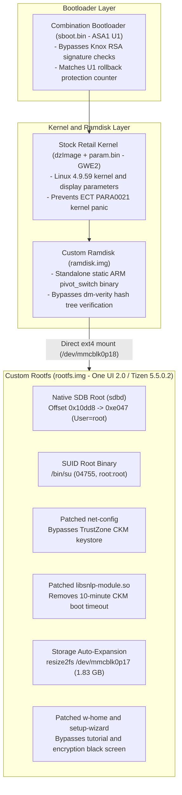
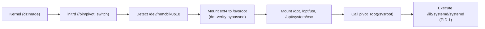
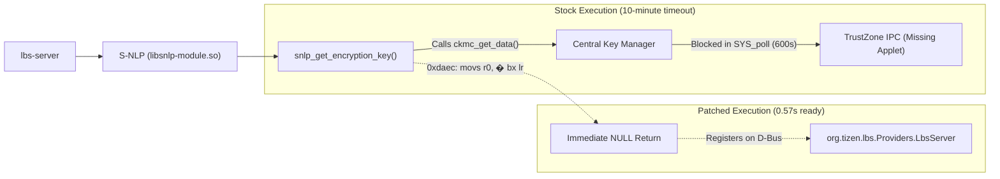
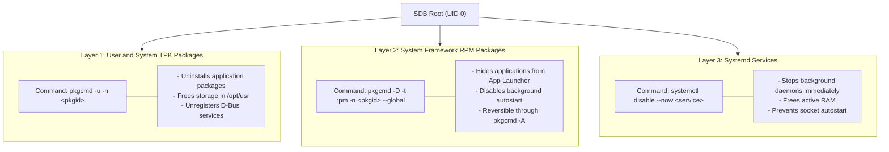

# Samsung Galaxy Watch (SM-R810) Operating System Customization and Root Manual

This document gives the technical procedures to get root access (UID 0), configure standalone operation, restore Wi-Fi networking, optimize GNSS location services, and remove bloatware on the Samsung Galaxy Watch (SM-R810).

---

## 1. Technical Specifications

| Parameter | Specification |
| :--- | :--- |
| **Device Model** | Samsung Galaxy Watch 42mm (`SM-R810`), Wi-Fi / Bluetooth |
| **Processor** | Samsung Exynos 9110 (Dual-Core ARM Cortex-A53, ARMv7-A 32-bit Thumb-2) |
| **Base Firmware** | Retail One UI 2.0 / Tizen 5.5.0.2 (`R810XXU1GWE2`, May 2023) |
| **Engineering Bootloader** | Combination Factory Firmware FT40 (`R810XXU1ASA1`, Revision U1) |
| **Kernel Version** | Linux `4.9.59` (`#1-Tizen SMP PREEMPT`) |
| **RAM / Flash Memory** | 768 MB LPDDR4 / 4 GB eMMC 5.1 |

### Summary of Results:
- **Standalone Mode:** Set up the watch without a mobile phone or companion application.
- **Native SDB Root:** Escalate privileges to root (`UID 0`) directly through `sdb root on` and `/bin/su`.
- **Integrity Bypass:** Replace `initrd` with a static ARM binary (`pivot_switch`) to bypass `dm-verity`.
- **Storage Expansion:** Expand `/opt/usr` from 112 MB to the full partition size of **1.83 GB** (1.72 GB available).
- **Wi-Fi Operation:** Bypass hardware Central Key Manager (CKM) calls in `net-config` to save passphrases and scan networks.
- **Assisted GPS:** Configure Google SUPL (`supl.google.com:7275`) to get a position lock in 1 to 3 seconds.
- **Fast System Boot:** Neutralize a 10-minute CKM timeout in `libsnlp-module.so`. The location service starts in 0.57 seconds.
- **System Debloat:** Remove 20 system packages, terminate 8 background daemons, delete 32 foreign voice packs, and free 92 MB of RAM.

---

## 2. Boot Architecture and Integrity Bypass

Samsung retail firmware uses security mechanisms to prevent unauthorized software:
1. **Knox RSA Verification:** The retail bootloader (`sboot.bin`) verifies partition signatures. It rejects modified `rootfs.img` files.
2. **Rollback Counter:** The hardware stops the boot process if you install an older bootloader revision.
3. **RPMB Security Lock:** Crypto Manager (`cm.bin`) binds cryptographically to the eMMC hardware RPMB key.
4. **Kernel Parameter Conflict:** The Combination kernel causes a kernel panic (`ECT PARA0021`) when you use it with Tizen 5.5 display drivers.
5. **dm-verity Verification:** The stock ramdisk validates rootfs block hashes. It causes a reboot loop if you modify `rootfs.img`.



### Exploit Strategy:
- **Match the Bootloader Revision:** Use `sboot.bin` from Combination firmware `FT40_R810XXU1ASA1`. Both firmwares share revision **`U1`**. This bootloader does not enforce RSA signatures on operating system partitions.
- **Keep Stock Kernel and Parameters:** Keep the kernel (`dzImage`) and parameters (`param.bin`) from `R810XXU1GWE2`. This prevents display driver faults and kernel panics.
- **Do Not Flash `cm.bin`:** Exclude `cm.bin` from custom flashing packages to prevent RPMB key mismatch errors.
- **Bypass `dm-verity` with `pivot_switch`:** Compile a static ARM binary (`pivot_switch`) with `arm-linux-gnueabi-gcc`. Replace `/usr/lib/initrd/initrd` inside `ramdisk.img`.



The `pivot_switch` binary executes these steps during boot:
1. Waits for partition `/dev/mmcblk0p18` to become available.
2. Mounts `/dev/mmcblk0p18` to `/sysroot` as read-only ext4.
3. Mounts `/dev/mmcblk0p16` to `/sysroot/opt`.
4. Mounts `/dev/mmcblk0p17` to `/sysroot/opt/usr`.
5. Mounts `/dev/mmcblk0p15` to `/sysroot/opt/system/csc`.
6. Moves `/dev`, `/proc`, and `/sys` to `/sysroot`.
7. Calls `syscall(SYS_pivot_root, "/sysroot", "/sysroot/mnt/initrd")`.
8. Detaches the initial ramdisk (`umount2("/mnt/initrd", MNT_DETACH)`).
9. Executes `/lib/systemd/systemd` as Process ID 1.

---

## 3. Tizen Security and Application Architecture Discoveries

Reverse engineering revealed fundamental restrictions in Tizen security policies:

### A. Hardcoded Root Privilege Checks in `pkgcmd`
Standard non-root SDB sessions cannot delete or disable pre-installed system applications:
- Running `pkgcmd -u -n com.samsung.wemail` fails with `Operation not allowed [-4]`.
- Running `pkgcmd -D -t tpk -n com.samsung.wemail` fails with `Undefined Error [-999]`.
- Disassembly of `/usr/bin/pkgcmd` revealed an explicit branch checking for root execution: `"This cmd is allowed for only root user"`.
- Modifying system applications requires root privileges.

### B. Partition Separation: System Apps vs. Preloaded User Apps
Tizen organizes applications across two storage locations:
- **System Applications (`/usr/apps/` in `rootfs.img`):** Read-only packages. Manifests mark these packages with `is_system=true` and `is_removable=false`. You cannot remove them without root permissions.
- **Preloaded User Applications (`/opt/usr/apps/` in `user.img`):** Applications stored under `.preload-rw-tpk` (e.g., `com.samsung.retailmodeplayer`, `com.samsung.samsung-pay-app`, `com.samsung.w-magazine-wc1`, and `com.samsung.alti-barometer`). Standard non-root SDB can uninstall them immediately with `pkgcmd -u -n <pkgid>`.

### C. Knox License Viewer Dependency in Standalone Setup
- During standalone setup, confirming the 2nd PIN prompt triggers the Device Policy Manager (`org.tizen.dpm-syspopup`).
- The manager starts `com.samsung.knox.license-viewer` to show legal agreements.
- If you delete Knox packages from `rootfs.img`, the wizard stops on a black screen.
- You must keep `com.samsung.knox.license-viewer`, `com.samsung.knoxcustom-exitui`, and `com.samsung.knoxenrollmentservice-efl` intact.

---

## 4. Native SDB Root Privilege Escalation

Retail firmware restricts root access. The Smart Development Bridge daemon (`sdbd`) denies elevation commands.

### Procedure:
1. **Patch `/usr/sbin/sdbd`:**
   Modify offset `0x10dd8`:
   - Stock bytes: `00 28` (`cmp r0, #0`)
   - Patched bytes: `47 e0` (`b.n 0x10e6a`)
   This change forces an unconditional jump to root shell execution.
2. **Configure `sdbd.service`:**
   Edit `/usr/lib/systemd/system/sdbd.service`:
   ```ini
   User=root
   Group=root
   ```
3. **Install SUID `/bin/su`:**
   Copy `/bin/su` from the Combination firmware and set permissions:
   ```bash
   chmod 4755 /bin/su
   chown root:root /bin/su
   setfattr -n security.SMACK64 -v "_" /bin/su
   ```

Connect to the watch and verify root access:
```bash
sdb root on
sdb shell
# whoami
root
```

---

## 5. Standalone Setup and User Interface Configuration

In standalone mode, the watch does not pair with a mobile device. Two software issues blocked the setup process:

### A. On-Device Encryption Bypass in `w-lockscreen-setting`
Entering a PIN invokes hardware encryption (`device_encryption_ode_encrypt_device`). Because the engineering bootloader does not run the Knox keystore applet, the function stops responding. The wizard stays on a black screen.

**Binary Patches:**
In `/usr/apps/com.samsung.w-lockscreen-setting/bin/w-lockscreen-setting`:
- `0xc394` (`device_encryption_ode_encrypt_device`): Change to `01 20 70 47` (`movs r0, #1; bx lr`).
- `0xc0f4` (`device_encryption_ode_change_password`): Change to `01 20 70 47` (`movs r0, #1; bx lr`).
- `0xc20c` (`device_encryption_ode_decrypt_device`): Change to `01 20 70 47` (`movs r0, #1; bx lr`).
- `0x1d988` (`util_device_is_encrypted`): Change to `00 20 70 47` (`movs r0, #0; bx lr`).

These modifications bypass the hardware encryption lock and store user PINs securely with SHA-256.

### B. Navigation Stack and Display Initialization in `b2-setup-wizard`
During development, two major failure modes occurred:
1. **Early Exit Failure:** Patching `_start` (`0xd230`) or `main` in `b2-setup-wizard` to `exit(0)` caused an unresponsive black screen. In Tizen, `b2-setup-wizard` is the primary display client started by `starter.service`. Exiting early terminates execution before Enlightenment and Wayland initialize the display surface.
2. **Stack Frame Imbalance Crash:** Tapping "Next" on the PIN screen caused a CPU crash. `_bottomButtonClickedCb` allocated a 40-byte stack frame (`sub sp, #16; push {r4-r8, lr}`). Jumping to `0x28ed8` used `_lockScreenAppControlReplyCb`'s 56-byte stack teardown (`add sp, #28; pop {r4-r9, pc}`), corrupting the stack pointer by 16 bytes.

**Resolution:**
Re-engineer `_bottomButtonClickedCb` at offset `0x29010` with inline assembly:
- Allocates and constructs `StuSettingUpViewController` (`0x2b918`).
- Pushes the view to the naviframe controller (`0xcd40`).
- Adjusts the stack pointer (`add sp, #16`).
- Returns cleanly to the EFL event loop (`ldmia.w sp!, {r4-r8, pc}`).

### C. Remove Rotary Tutorial in `w-home`
On first boot, `w-home` shows an overlay window to teach rotary bezel navigation. In standalone mode, this window does not register input listeners. It captures all touches and stops user input.

**Procedure:**
1. Patch `/usr/apps/com.samsung.w-home/bin/w-home` at offset `0x814b0`:
   - Replace `10 b5 04 46` with `8c e7 00 bf` (`b.n 0x813cc; nop`).
   This bypasses the tutorial window constructor.
2. Initialize system configuration keys in `/usr/bin/oobe-finish.sh`:
   ```bash
   vconftool set -t int "db/private/com.samsung.w-home/tutorial_oobe_enabled" 0 -g 5000 -f -s com.samsung.w-home
   vconftool set -t int "db/private/com.samsung.w-home/oobe_state" 0 -g 5000 -f -s com.samsung.w-home
   vconftool set -t int "db/setup_wizard/first_boot" 0 -f
   vconftool set -t int "db/setting/setup_wizard_finish" 1 -f
   ```

### D. Offline Debloat Registry Fragility
Deleting application packages directly from `rootfs.img` before first boot caused setup failures. Tizen uses inter-dependent vconf keys and SQLite databases in `/opt`. Missing package registrations during enrollment cause startup deadlocks.
- The reliable approach keeps a clean system rootfs image and performs live debloating with root privileges after first boot.

---

## 6. Wi-Fi Subsystem Configuration

### Cause of Wi-Fi Failure
On retail firmware, `net-config` calls Central Key Manager (CKM) functions to encrypt passphrases:
```c
ckmc_create_key_aes(...);
ckmc_encrypt_data(...);
ckmc_decrypt_data(...);
```
These functions require TrustZone applets. When you use the engineering bootloader, these applets are missing. The program stops with an error, and the Wi-Fi menu closes.

### Technical Pitfalls and Resolutions:
1. **Thumb/ARM State Transition Trap (`SIGILL`):**
   Branching from Thumb-2 code with `b.w 0xa918` jumped into an ARM PLT stub without changing the processor instruction state (`T-bit`). This generated an Illegal Instruction fault (`SIGILL`) and killed `net-config`.
   - The fix uses valid interworking: `push {lr}; blx 0xa918; pop {pc}` (`00 b5 de f7 2e ec 00 bd`).
2. **Bypass CKM Functions in `/usr/bin/net-config`:**
   Bypass AES encryption routines and return string duplicates with `g_strdup`:
   - Offset `0x2c0ca`: Change `df f8 c0 b2` to `04 46 ab e0` (`mov r4, r0; b 0x2c226`).
   - Offset `0x2bd3a`: Change `05 a9 05 46` to `06 46 d1 e0` (`mov r6, r0; b 0x2bee2`).
3. **Restore Linux File Capabilities:**
   Modifying the binary file removes POSIX file capabilities. You must apply them again manually:
   ```bash
   setcap cap_dac_override,cap_net_admin,cap_net_raw=ei /usr/bin/net-config
   setfattr -n security.SMACK64 -v "_" /usr/bin/net-config
   chown 551:551 /usr/bin/net-config
   chmod 0500 /usr/bin/net-config
   ```
4. **Broadcom Hardware Radio Power Management:**
   In stock `wifi_bin` at offset `0x24e0e`, if the radio was off, the UI showed `popup_scanning_show` without creating the scan list layout, causing a bounce-back to the main menu. Forcing `wifi_is_activated` to return 1 caused a `SIGSEGV` crash because register `r1` was uninitialized.
   - The solution keeps the original `wifi_bin` binary to power on the Broadcom radio cleanly, sets `[WiFi] Enable=true` in `/var/lib/connman/settings`, and applies patches only to `net-config`.

---

## 7. GNSS Location Subsystem Optimization

### A. Remove the 10-Minute Boot Timeout
After boot, the location service (`lbs-server`) stopped responding for 600 seconds. A debugger showed Thread 1 blocked in system call 168 (`SYS_poll`).



The Samsung Network Location Provider (`libsnlp-module.so.0.2.53`) queried CKM for encryption keys. Because CKM did not respond, `lbs-server` waited 600 seconds before it registered on D-Bus.

**Binary Patch:**
In `/usr/lib/libsnlp-module.so.0.2.53` at offset `0xdaec` (`snlp_get_encryption_key`):
- Stock bytes: `2d e9 f0 4f` (`stmdb sp!, {r4-r8, r9, sl, fp, lr}`)
- Patched bytes: `00 20 70 47` (`movs r0, #0; bx lr`)

This change returns `NULL` immediately. The service registers on D-Bus in 0.57 seconds.

### B. Configure Google SUPL Assisted GPS
The original Nokia/HERE location server is offline. Set Google SUPL configuration keys:
```bash
vconftool set -t string "db/location/supl/Server" "supl.google.com" -f
vconftool set -t int "db/location/supl/Port" 7275 -f
vconftool set -t int "db/location/supl/SslEnabled" 1 -f
```
The GPS receiver acquires satellite signals in 1 to 3 seconds.

### C. Configure Watchdog and Permissions
- Create `/etc/systemd/system/lbs-server.service.d/override.conf`:
  ```ini
  [Service]
  Type=simple
  WatchdogSec=0
  TimeoutStartSec=infinity
  ```
- Set `location:location` ownership on `/opt/gnss`. This gives the Broadcom daemon `gpsd` (`uid=654`) read and write access to the communication pipe `/opt/gnss/.gps.interface.pipe.to_jni`.

---

## 8. Storage Partition Expansion

The stock firmware image for `user.img` is 112 MB. Only 29 MB is free space. The custom `pivot_switch` bypasses the stock initrd script that resizes this filesystem.

**Procedure:**
Add resize commands to `/usr/bin/oobe-finish.sh`:
```bash
/sbin/resize2fs /dev/mmcblk0p17
/sbin/resize2fs /dev/mmcblk0p16
```
This expands `/opt/usr` to the full boundary of **1.83 GB** (1.72 GB available).

---

## 9. Operating System Debloat Procedure

Use this three-layer structure to remove and deactivate unnecessary software:



### Execution Commands:

#### 1. Deactivate Companion Synchronization Services:
```bash
pkgcmd -D -t rpm -n com.samsung.app-list-backup-service --global
pkgcmd -D -t tpk -n com.samsung.contacts-backup-service --global
pkgcmd -D -t rpm -n com.samsung.ime-backup-service --global
pkgcmd -D -t tpk -n com.samsung.message-backup-service --global
pkgcmd -D -t rpm -n com.samsung.wis-backup-service --global
pkgcmd -D -t rpm -n com.samsung.w-samsung-cloud --global
pkgcmd -D -t tpk -n com.samsung.cmc --global
pkgcmd -D -t tpk -n com.samsung.mdec-consumer --global
pkgcmd -D -t tpk -n com.samsung.fmg --global
pkgcmd -D -t tpk -n com.samsung.fmm --global
pkgcmd -D -t rpm -n net.wc-popup --global
pkgcmd -D -t rpm -n net.wc-syspopup --global
```

#### 2. Deactivate Telemetry and Diagnostic Daemons:
```bash
pkgcmd -D -t tpk -n com.samsung.runestone-core --global
pkgcmd -D -t tpk -n com.samsung.runestone-gear --global
pkgcmd -D -t tpk -n com.samsung.runestone-setting --global
pkgcmd -D -t tpk -n com.samsung.tizen.samsung-analytics --global
pkgcmd -D -t tpk -n com.samsung.logdump-uploader --global
pkgcmd -D -t rpm -n gps-log-service --global

systemctl disable --now sanalyticsd.service sanalyticsd.socket
systemctl disable --now gpsslogd.service
systemctl disable --now bluetooth-hci-logger.service
systemctl disable --now diagd.service
systemctl disable --now dumpsys-service.service
```

#### 3. Deactivate Voice Assistant Packages:
```bash
pkgcmd -D -t tpk -n com.samsung.tizen.bixby --global
pkgcmd -D -t tpk -n com.samsung.tizen.bixby-voice --global
pkgcmd -D -t tpk -n com.samsung.tizen.bixby-provisioning --global
pkgcmd -D -t rpm -n com.samsung.tizen.bixby-wakeup-service --global
pkgcmd -D -t tpk -n com.samsung.tizen.iva-service --global
```

#### 4. Deactivate Telephony Daemons (Device has no cellular modem):
```bash
systemctl disable --now telephony-daemon.service
systemctl disable --now ims-daemon.service
pkgcmd -D -t rpm -n com.samsung.imssettings --global
```

#### 5. Delete Foreign Voice Packs:
Delete unused text-to-speech files from `/usr/share/voice/tts/smt_vdata/`:
```bash
mount -o remount,rw /
find /usr/share/voice/tts/smt_vdata/ -type f ! -name 'smt_en_US*' -delete
mount -o remount,ro /
```
This removes 150 MB of files from the read-only rootfs partition.

### Performance Comparison:

| Measurement | Stock Firmware | Custom Firmware | Improvement |
| :--- | :--- | :--- | :--- |
| **Available RAM** | 272 MB | **364 MB** | **+92 MB RAM free** |
| **Used RAM** | 395 MB | **302 MB** | **-93 MB RAM used** |
| **Swap Usage** | 61 MB | **47 MB** | **-14 MB swap used** |
| **Active Daemons** | 69 units | **61 units** | **8 daemons removed** |
| **App Drawer** | 3 pages | **1 page** | Clean interface |
| **GPS Fix Latency** | Failed / 600s timeout | **1 to 3 seconds** | Fast Google SUPL lock |
| **Available Storage** | 29 MB | **1,720 MB (1.72 GB)** | **59x more user storage** |

---

## 10. Firmware Packaging and Flashing Procedure

Package the partition images into a standard POSIX `ustar` archive with root ownership (`0:0`). Append an Odin MD5 checksum to the archive.

### Partition File Sequence:
```
1. sboot.bin              (Combination FT40 ASA1 Bootloader)
2. param.bin              (Stock Retail Parameters)
3. dzImage                (Stock Retail Kernel)
4. ramdisk.img            (Custom dm-verity Bypass Ramdisk)
5. ramdisk-recovery.img   (Stock Retail Recovery Ramdisk)
6. rootfs.img             (Custom Standalone Rootfs - 1.36 GB ext4)
7. system-data.img        (Stock Retail System Data - 93.3 MB ext4)
8. user.img               (Stock Retail User Storage Base - 112 MB ext4)
```

> **Important:** Use GNU tar to build the archive. Do not use macOS BSD tar. NetOdin rejects archives with non-standard POSIX pax headers (`uname` and `gname`) with error `RQT_Read fail`.

### Create the Package:
```bash
tar -H ustar -c --owner=0 --group=0 -f firmware.tar \
    sboot.bin param.bin dzImage ramdisk.img ramdisk-recovery.img rootfs.img system-data.img user.img

md5sum -t firmware.tar >> firmware.tar
mv firmware.tar firmware.tar.md5
```

### Installation Steps:
1. **Enter Wireless Download Mode:**
   - Press and hold the Home/Power button until the watch shows `Rebooting...`.
   - Release the button and press it repeatedly until the **Reboot Menu** appears.
   - Select **Download (Wireless)**, then press and hold the button.
   - On the WPS screen, press the Home/Power button twice to start **AP Mode** (`Access Point: SM-R810-xxxx`).
2. **Flash Firmware with NetOdin3:**
   - Connect your computer to the Wi-Fi access point of the watch.
   - Start **NetOdin3.exe**. Verify that the connection indicator turns blue.
   - Select the `.tar.md5` file in the **AP** field.
   - Click **Start** to write the partitions. Wait until NetOdin shows **PASS!**.
3. **Complete Device Setup:**
   - The watch starts the standalone setup wizard.
   - Create a 4-digit PIN and accept the terms.
   - Open **Settings > Connections > Wi-Fi > Wi-Fi networks**, select your network, and type the password.
4. **Verify Root Access:**
   ```bash
   sdb root on
   sdb shell
   # whoami
   root
   # df -h /opt/usr
   Filesystem      Size  Used Avail Use% Mounted on
   /dev/mmcblk0p17 1.8G  112M  1.7G   6% /opt/usr
   ```

---

## 11. Emergency Recovery and Unbrick Procedures

Use these procedures if the device stops responding or enters a boot loop:

### A. Force Reset from Upload Mode or Hangs
If the watch hangs on `Rebooting...` or enters kernel panic upload mode (`ECT PARA0021`):
1. Press and hold the **Home/Power (bottom)** button continuously for 12 to 15 seconds.
2. The hardware will perform a forced power reset.
3. Release the button immediately when the display goes dark.
4. Tap the button rapidly to open the Samsung Reboot Menu.

### B. Recovery Wipe (Cache and Stale Database Clear)
If the watch stops on the Samsung logo because of stale SQLite database entries in `/opt`:
1. Enter the Samsung Reboot Menu.
2. Select **Recovery**, then press and hold the Home/Power button.
3. Stock recovery will start, clear cache partitions and user databases, and restart the setup wizard cleanly.

### C. Revert to Factory Retail Firmware
To restore the device to official factory stock:
1. Load official stock firmware archives into NetOdin3:
   - `AP`: `AP_R810XXU1GWE2_usr.tar.md5`
   - `BL`: `BL_R810XXU1GWE2_usr.tar.md5`
   - `CSC`: `CSC_OXA_R810OXA1GWE2_usr.tar.md5`
2. Connect to the watch access point in Wireless Download Mode.
3. Click **Start** to restore official retail software.
